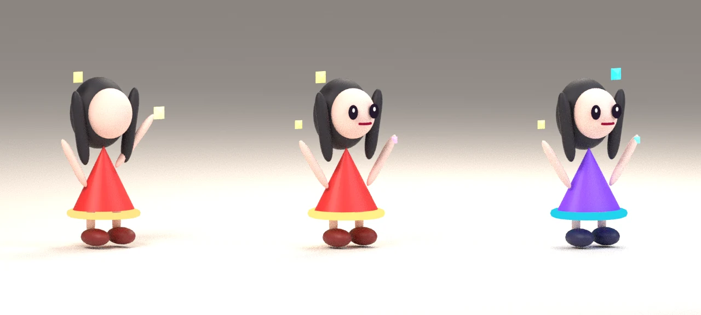
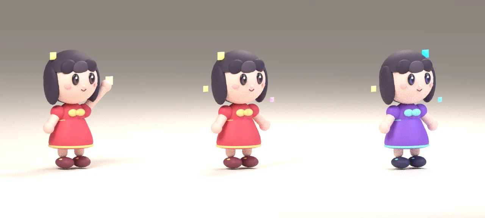
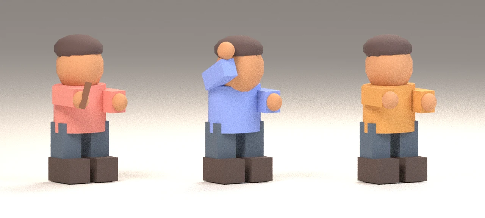
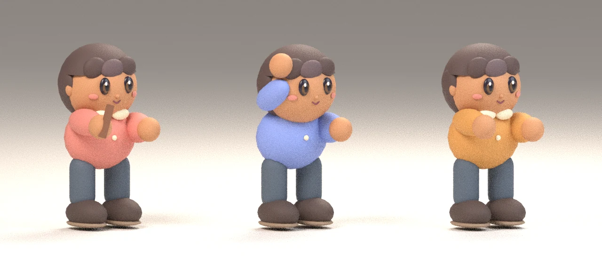
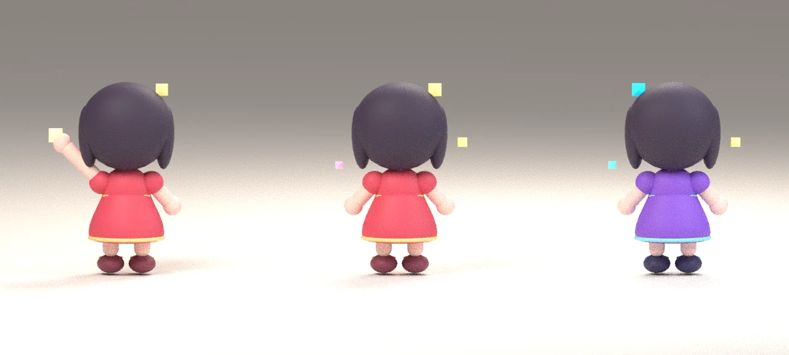

# Island chibi figurines — candidate for PR #16

Prepared November 27, 2026, from integration head `66d3430cc1972622b73debda1467ad0fd1340adb` in response to Eric's request for cuter, more dimensional island characters.

## Integration route

This is an isolated visual candidate for the existing PR #16 integration owner. The coordination record in [issue #11](https://github.com/Sventography/Nova_Tutoring_expo/issues/11#issuecomment-7205843900) keeps feature refs frozen. Review and incorporate through that owner, recheck for newer integration changes, and rerun the focused island checks. This candidate does not merge or deploy the application.

## Changes

- A shared, fully volumetric head gives the three human companions and all district resident variants larger rounded faces, layered hair, dimensional eyes with highlights, cheeks, a small nose and a visible smile.
- Star Toss, Party and Neon Party have rounded bodices and bell skirts, puff sleeves, short limbs, mitten hands and rounded shoes. Their red/gold and purple/cyan identities remain.
- District residents have rounded coats, collars, limbs and shoes with the same district colors and role props. Their shared head uses a shorter hairstyle and a scale of 0.52 so overall height remains close to the existing figure.
- Static parts are combined into vertex-colored meshes. A companion body/head uses three draws; a district resident uses four, or five with its existing brush. No textures, dependencies, new lights, dynamic shadows or extra animation loop were added.

The island remains actual Three.js geometry. Existing movement/action callbacks, outer character refs and scales, action prop refs, district arm pivot, tool coordinates, placement, growth, navigation and reduced-motion behavior are unchanged. Lunis, the bunny, abstract spirits and shop artwork are outside this pass.

## Model previews

These images render the actual source triangle positions, normals, vertex colors, roughness and emission in Blender 4.3.2 Cycles CPU. Matching before/after pairs use the same camera and framing. Studio lighting and the neutral floor are illustrative. They are geometry previews, not screenshots of the island or evidence of browser/native execution.

### Companions before

### Companions after

### District residents before and after

### Companion rear view

Visual inspection found the eyes visible beneath the fringe, facial features seated on the head, connected side/rear hair volume, the raised hand meeting its retained star, and the painting tool still meeting its hand. The observer's raised hand at its forehead is an existing pose. These inspected views cannot establish all animated contacts or final island lighting.

## Local verification

| Check | Result |
| --- | --- |
| Node | 22.23.5 |
| Project TypeScript comparison | Baseline and candidate each exit 2 with 1,024 existing diagnostics; zero normalized additions/removals. This is not a clean project typecheck. |
| `node scripts/test-living-island.cjs` | Passed: 720 ordered interest trios across four stages, real Three transforms/footprints, placement consistency, save rollback and isolation. |
| Geometry checks | Finite matched position/normal/color buffers; normalized transformed normals; finite bounds; owned temporary input disposal and output cleanup. |
| `git diff --check` | Passed. |
| Isolated Expo web export | Passed with `scripts/export-vercel.cjs`, offline mode, staging URL, dummy publishable key, disabled backend and a fresh output directory. |
| Visual review | Actual mesh previews reviewed from three-quarter and rear angles; district before/after inspected. |

The export initially encountered unmaterialized Git LFS image pointers in the new checkout. All 155 required existing assets were copied from the clean baseline checkout only after matching the pointer's SHA-256 and byte size; no artwork was changed. The subsequent export completed successfully.

## Limits and owner checks

The supplied browser could load the preview page but could not create a WebGL context. No browser GPU settings were changed and the application has no added 2D fallback. Live WebGL/Expo GL behavior, phone frame times, memory after repeated mount/unmount and final day/night island lighting remain unverified.

The static merged companion body/head has 12,674 triangles and about 1.31 MiB of vertex attributes. Across the sampled three-companion lineup, source mesh count falls from 54 to 17 while triangles rise from 13,764 to 38,086; the sampled district trio falls from 34 to 13 meshes while triangles rise from 1,812 to 29,838. These source counts include existing props and are not measured GPU speed improvements. Check older iPhone/Android performance and distant-view readability before release.

After owner integration, inspect the characters in the real island at normal and close viewing distances, rotate through front/side/rear views, check moving arms and action props, visit districts with motion on/off, return to the island and repeat navigation. Hosted preview and physical-device results should be recorded separately from this local candidate evidence.
